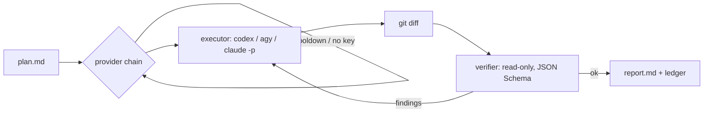

# cheap-exec

**Plan with the expensive model. Execute with the cheap ones. Verify independently.**

[](https://github.com/arnaugonzalez/cheap-exec/actions/workflows/ci.yml)


You already have a good plan, written by you or by a frontier model. Having that same model type
out every line is the expensive part. cheap-exec hands the plan to a headless coding agent: the
CLI subscriptions you already pay for first (Codex, Antigravity, Claude Code), then any cheap API
you configure (OpenRouter, DeepSeek, GLM, a local model). It switches providers when one runs out
of quota, and then has a **separate, read-only reviewer** check the git diff against the plan. The reviewer returns a typed verdict. If
the verdict is not `ok`, its findings go back to the executor for a repair round.

<!-- demo GIF (≤20 s): cheap-exec run → provider fallback → verdict → report.md -->

## Quickstart

Requires Python 3.11+, git and at least one agent CLI. The default config tries, in order,
[Codex CLI](https://github.com/openai/codex) (`codex login` with a ChatGPT plan), Antigravity `agy`,
and [Claude Code](https://docs.claude.com/en/docs/claude-code) on [OpenRouter](https://openrouter.ai/keys)
with an API key. The verifier is Claude Code on your own Claude login. Providers you don't have are
skipped; edit the chain to match what you use.

```bash
pipx install cheap-exec            # or: uv tool install cheap-exec
cheap-exec init                    # writes ~/.config/cheap-exec/config.json and .env
echo "OPENROUTER_API_KEY=sk-or-..." >> ~/.config/cheap-exec/.env   # optional API fallback
cheap-exec run --plan PLAN.md --cwd path/to/repo
```

`cheap-exec status` shows which providers are ready (binary found, logged in or key present) and
which are cooling down. Plans are plain Markdown; see [`examples/plans/`](examples/plans/).

## What a run looks like

```
plan.md ─► executor #1 ──quota / hang / error──► executor #2 ──► …
                │ changes in the working tree
                ▼
        git diff + untracked files ─► verifier (other process, read-only, JSON Schema)
                │
     ok ────────┴──── incomplete / out_of_scope / regression ─► repair round with the findings
     │
     ▼
report.md · ledger.jsonl · exit code 0 (verified) / 2 (not verified) / 3 (verification pending) / 1 (config error)
```



## Why this and not…

Each piece exists elsewhere. What cheap-exec adds is the loop around them: the plan is the
contract, a verifier in a separate process checks the diff against it, and every run leaves an
auditable cost record.

| | Better at | cheap-exec differs by |
|---|---|---|
| **Aider** architect/editor | Built-in two-model workflow, repo map, auto lint/test | Wrapping any agent CLI, an independent verifier process, provider fallback with cooldowns |
| **LiteLLM** router / proxy | Production-grade fallbacks, retries, budgets, cost tracking at the HTTP layer | Knowing what a plan and a diff are. The two combine: point a provider's `base_url` at your LiteLLM proxy |
| **claude-code-router** | Routing Claude Code requests per scenario (background, long context) to many providers | A run with a verdict and a cost figure, not a request router |
| **OpenHands / opencode / Codex `exec`** | Full agent platforms: sandboxing, many providers, rich UIs | Being one stdlib-only Python file (~1k lines) of glue *around* such agents, meant to be called by another agent or CI |
| **Claude Code subagents** | Zero setup inside a session | Using non-Claude models without a proxy, and a verifier that does not share the parent's context |

## Configuration

`$XDG_CONFIG_HOME/cheap-exec/config.json` (default `~/.config/cheap-exec/config.json`), created
by `cheap-exec init`. Keys go in `.env` in the same directory (mode 600) or in the environment.

```jsonc
{
  "chain": ["codex", "agy", "openrouter"],         // executors, tried in order
  "verify": {"provider": "claude-login", "tier": "pro"},
  "max_rounds": 2,
  "on_event": null,                                // shell command, gets each event as JSON on stdin
  "providers": {
    "codex": {
      "kind": "codex",                             // `codex exec`, your own Codex login
      "models": {"flash": "gpt-5.4-mini", "pro": "gpt-5.4"},
      "billing": "subscription"
    },
    "openrouter": {
      "kind": "claude",                            // Claude Code as the agent harness
      "base_url": "https://openrouter.ai/api",     // any Anthropic Messages-compatible endpoint
      "key_env": "OPENROUTER_API_KEY",
      "models": {"flash": "deepseek/deepseek-v4.1-flash", "pro": "z-ai/glm-5.3"},
      "max_budget_usd": 2.0,
      "billing": "paid",                           // paid | subscription | local
      "prices": {"deepseek/deepseek-v4.1-flash": [0.14, 0.0042, 0.42]}  // USD / 1M: in, cached in, out[, cache write]
    }
  }
}
```

Presets in the generated config: `codex`, `agy`, `openrouter`, `deepseek` (with its off-peak/peak pricing),
`zai` (GLM), `anthropic` (API key), `claude-login` (your own Claude Code subscription login) and
`ollama` (local; also works with LM Studio, vLLM, llama.cpp or a LiteLLM proxy, since they all expose
the Anthropic Messages API). Prices are dated (`prices_as_of`) and will go stale: check the
provider's page.

| Field | Meaning |
|---|---|
| `kind` | `claude` (Claude Code `claude -p`), `codex` (Codex CLI `codex exec`) or `agy` (Google Antigravity CLI). The verifier must be `claude` or `codex` (both enforce a JSON Schema) |
| `base_url` / `key_env` | Endpoint and the environment variable that holds its key. No `base_url` means Anthropic itself |
| `use_login` | Use your own Claude Code login instead of a key (subscription usage) |
| `env` | Extra environment variables for that provider; `$KEY` is replaced by the key |
| `models.flash` / `models.pro` | Chosen with `--tier flash|pro` |
| `timeout_s`, `max_budget_usd` | Per-attempt limits |
| `peak` | Optional price multiplier by UTC hour window |

`--tier`, `--chain a,b`, `--verify <provider>|none`, `--max-rounds` and `--on-event` override the
config per run. Other commands: `usage --days 7 [--json]`, `verify --run <id>` (retry only the
verification), `cooldown <provider> [--minutes N | --clear]`.

## Measured cost

One run of [`examples/plans/add-healthcheck.md`](examples/plans/add-healthcheck.md) on a small FastAPI
repo, 2026-09-24. Figures come from each run's `report.md` (`cheap-exec usage --days 1` sums them).
For the first two rows the OpenRouter balance moved $0.2551, against $0.2639 estimated.

| Setup | Executor | Verifier | Total |
|---|---|---|---|
| DeepSeek V4.1 Flash executes, Sonnet 5 verifies (`verified OK`, 1 round) | $0.0031 · 70k tokens · 23 s | $0.1219 · 142k tokens | **$0.125** |
| Sonnet 5 executes, no verification | $0.1389 · 185k tokens · 22 s | — | **$0.139** |
| DeepSeek executes, Sonnet verifies on a Claude subscription (`--verify claude-login`, `verified OK`) | $0.0033 · 70k tokens · 6 s | subscription (Claude Code prices it at $0.137) | **$0.003 paid** |

On a plan this small the verifier dominates the bill, so verifying on a subscription you already
pay for is where the saving is. The cheaper executor matters more as plans grow.

## Events and integrations

`--on-event CMD` (or `"on_event"`) runs `CMD` through the shell for `run_start`, `attempt`,
`verify` and `run_end`. Each event arrives as one JSON object on stdin, and a failing hook never
stops a run. [`examples/hooks/`](examples/hooks/) has desktop notifications, [apprise](https://github.com/caronc/apprise)
(Telegram, Slack, ntfy, email…) and a JSONL log.

## Limits and non-goals

- **The executor runs with permission prompts off.** Use a dedicated worktree or a container. See
  [SECURITY.md](SECURITY.md).
- The verifier is a model too: it catches missing tasks and scope creep well, but it is not a test
  suite. Put real checks in your plan and it will run them.
- The target directory must be a git repository, because the verifier reviews `git diff`.
- Subscription CLIs (`codex`, `agy`, `claude-login`) spend your plan's limits and are bound by each
  vendor's terms; Google's Antigravity terms in particular restrict use with third-party tools.
  Read them before you script it. For CI, use API keys.
- Linux and macOS. Windows is untested.

## Roadmap

- Generic hang watchdog for the `claude` adapter (it currently gets a timeout only).
- An opencode adapter, for endpoints that only speak the OpenAI API.
- Optional pre-verification checks (`lint`/`test` commands) that run before the verifier.

## License

MIT
