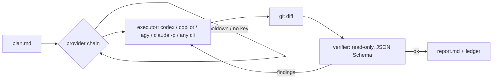

# execute-cheaper

**Your best model is a brilliant architect and a very expensive typist.**<br>
Let it plan. Hand the typing to the coding CLIs you already pay for. Have someone else check the work.

[](https://github.com/arnaugonzalez/execute-cheaper/actions/workflows/ci.yml)
[](https://pypi.org/project/execute-cheaper/)


<sub>A real run with idle frames cut. `cursor-agent` isn't installed, so the chain falls back to GitHub
Copilot, then a separate, read-only Claude reviewer checks the diff against the plan.</sub>

It is not another coding agent (you have enough of those). It is one Python file that sits between
the ones you already have.

## What you can do with it

- **Stop spending Claude Code's usage limits on typing.** Write the plan in Claude Code or with Opus, then let
  the ChatGPT Free, Copilot Student or Antigravity plan you forgot about do the typing.
- **Keep going when a quota runs out.** The chain falls through the routes you picked (say Codex →
  Copilot → OpenRouter) and remembers cooldowns between runs, so it stops knocking on closed doors.
- **Get a review that can't mark its own homework.** The verifier runs in another process with no
  edit tools, compares `git diff` to the plan and answers `ok`, `incomplete`, `out_of_scope` or
  `regression`. Anything but `ok` goes back to the executor with the findings.
- **Hand it to CI or to another agent.** Exit codes 0/1/2/3 and a `report.md` for every run.
- **Run it fully local** with Ollama, LM Studio or anything else that speaks the Anthropic Messages API.
- **Know what each task cost**, split into money paid and subscription usage.

Same plan, measured on 2026-09-24 ([how](#measured-cost)): **$0.139** with Sonnet doing everything ·
**$0.003** with DeepSeek typing and a Claude subscription reviewing · **$0** on ChatGPT's Free plan.

## Install

```bash
pipx install execute-cheaper      # or: uv tool install execute-cheaper
execute-cheaper init              # shows the CLIs and keys it found, asks which to use, writes the config
execute-cheaper status            # whether every route you picked can run
execute-cheaper run --plan PLAN.md --cwd path/to/repo
```

Needs Python 3.11+, git and at least one of these. Whatever you don't have is skipped.

| | Measured by the author | Also supported |
|---|---|---|
| **Subscriptions** | Codex CLI (`codex login`, ChatGPT Free and up) · GitHub Copilot CLI (Student and up) · your Claude Code login · opencode (free models) | Antigravity `agy` · Cursor CLI (`cursor-agent`, untested) · Gemini CLI as an [untested preset](examples/providers/) |
| **APIs** | OpenRouter | DeepSeek · Z.ai GLM · Anthropic · any Anthropic Messages-compatible endpoint |
| **Local** | | Ollama · LM Studio · vLLM · llama.cpp · LiteLLM proxy |

A plan is plain Markdown: the tasks, what is out of scope, and the checks to run. See
[`examples/plans/`](examples/plans/). Free and student plans restrict which models you get; see
[Limits](#limits-and-non-goals).

### Pick your routes

`init` looks for the coding CLIs and API keys you have (key names only: values are never printed), then
asks which routes to use, in what order, and who verifies. The defaults are what it detected, in its
order, with a verifier from a different vendor than the executors. Antigravity (`agy`), opencode, Cursor
(`cursor-agent`) and local servers are never picked for you: name them. Only the routes you choose go into `config.json`, and `.env` gets an
empty line only for the keys they still need.

```bash
execute-cheaper init --detect          # what it found; writes nothing (--json for agents)
# ChatGPT subscription types, your Claude subscription reviews:
execute-cheaper init --chain codex --verify claude-login
# Only Claude and API keys: cheap models type, your Claude login reviews:
execute-cheaper init --chain deepseek,openrouter --verify claude-login
# Antigravity and Claude (read Google's terms first, see Limits):
execute-cheaper init --chain agy --verify claude-login
# Cursor first, opencode's free models as fallback (the chain in the demo GIF, plus opencode):
execute-cheaper init --chain cursor,opencode,copilot --verify claude-login
```

Without a terminal, `init` takes the detected routes (`--yes` says so explicitly). It exits 1 without
writing anything when nothing usable is found. It never overwrites a config unless you pass `--force`,
and repeating the same `--chain`/`--verify` is a no-op.

### Set it up from your agent

Claude Code, Codex or any agent with a shell can do the whole setup in your chat (tried with Claude Haiku
and with `codex exec`, each in a scratch config directory). Paste this:

```text
Install execute-cheaper (pipx install execute-cheaper) and set it up for me by following
https://github.com/arnaugonzalez/execute-cheaper/blob/main/AGENTS.md: run `execute-cheaper init --detect --json`,
show me the routes it found, ask me which executors to use, in what order, and which verifier, then
run `init --chain ... --verify ... --json` and `status --json`. Never ask me for an API key in the
chat: tell me the file and the variable name and I will paste it there myself.
```

The JSON from `init --detect --json` and `status --json` is versioned (`"schema": 1`) and holds key
names and where they are set (`env`, `.env` or `null`), never their values. With the plugin below,
`/execute-cheaper:setup` runs the same flow. Cline and other agents that look for
[`llms-install.md`](llms-install.md) get the short version there.

### From Claude Code

Plan in Claude Code, then let it hand the plan off: the plugin adds a skill that writes the plan as a
contract, launches `execute-cheaper` in the background and reads only the verdict.

```text
/plugin marketplace add arnaugonzalez/execute-cheaper
/plugin install execute-cheaper@execute-cheaper
```

Then ask for it in plain words ("run this plan cheaply", "let Codex implement it, I'm close to my
usage limit"). The skills are plain `SKILL.md` files in [`plugin/skills/`](plugin/skills/): `execute-cheaper`
runs plans, `setup` (`/execute-cheaper:setup`) configures your routes from the chat.

## What a run looks like

```
plan.md ─► executor #1 ──quota / hang / error──► executor #2 ──► …
                │ changes in the working tree
                ▼
        git diff + untracked files ─► verifier (other process, read-only, JSON Schema)
                │
     ok ────────┴──── incomplete / out_of_scope / regression ─► repair round with the findings
     │
     ▼
report.md · ledger.jsonl · exit code 0 (verified) / 2 (not verified) / 3 (verification pending) / 1 (config error)
```



## Why this and not…

Each piece exists elsewhere. What execute-cheaper adds is the loop around them: the plan is the
contract, a verifier in a separate process checks the diff against it, and every run leaves an
auditable cost record.

| | Better at | execute-cheaper differs by |
|---|---|---|
| **Aider** architect/editor | Built-in two-model workflow, repo map, auto lint/test | Wrapping any agent CLI, an independent verifier process, provider fallback with cooldowns |
| **LiteLLM** router / proxy | Production-grade fallbacks, retries, budgets, cost tracking at the HTTP layer | Knowing what a plan and a diff are. The two combine: point a provider's `base_url` at your LiteLLM proxy |
| **claude-code-router** | Routing Claude Code requests per scenario (background, long context) to many providers | A run with a verdict and a cost figure, not a request router |
| **OpenHands / opencode / Codex `exec`** | Full agent platforms: sandboxing, many providers, rich UIs | Being one stdlib-only Python file (~1.6k lines) of glue *around* such agents, meant to be called by another agent or CI |
| **Claude Code subagents** | Zero setup inside a session | Using non-Claude models without a proxy, and a verifier that does not share the parent's context |

## Configuration

`$XDG_CONFIG_HOME/execute-cheaper/config.json` (default `~/.config/execute-cheaper/config.json`), created
by `execute-cheaper init`. Keys go in `.env` in the same directory (mode 600) or in the environment.

```jsonc
{
  "chain": ["codex", "copilot", "openrouter"],     // the executors you picked, tried in order
  "verify": {"provider": "claude-login", "tier": "pro"},
  "max_rounds": 2,
  "on_event": null,                                // shell command, gets each event as JSON on stdin
  "providers": {
    "codex": {
      "kind": "codex",                             // `codex exec`, your own Codex login
      "models": {"flash": "gpt-5.6-luna", "pro": "gpt-5.6-terra"},
      "billing": "subscription"
    },
    "copilot": {
      "kind": "cli",                               // any headless coding CLI, described here
      "cmd": ["copilot", "-p", "{prompt}", "--model", "{model}", "--yolo", "--no-ask-user", "-s",
              "--usage-output-file", "{run_dir}/{label}-usage.json"],
      "fail_re": "^Execution failed",              // Copilot exits 0 on some failures
      "usage_file": "{run_dir}/{label}-usage.json",
      "usage": {"input_tokens": "tokenDetails.input.tokenCount", "output_tokens": "tokenDetails.output.tokenCount"},
      "models": {"flash": "auto", "pro": "auto"},  // paid plans can pin e.g. "claude-sonnet-4.5"
      "billing": "subscription"
    },
    "openrouter": {
      "kind": "claude",                            // Claude Code as the agent harness
      "base_url": "https://openrouter.ai/api",     // any Anthropic Messages-compatible endpoint
      "key_env": "OPENROUTER_API_KEY",
      "models": {"flash": "deepseek/deepseek-v4.1-flash", "pro": "z-ai/glm-5.3"},
      "max_budget_usd": 2.0,
      "billing": "paid",                           // paid | subscription | local
      "prices": {"deepseek/deepseek-v4.1-flash": [0.14, 0.0042, 0.42]}  // USD / 1M: in, cached in, out[, cache write]
    }
  }
}
```

Built-in presets `init` offers (all of them are in [`config.example.json`](config.example.json); the
generated config keeps only the ones you pick): `codex`, `copilot`, `opencode`, `cursor`, `agy`, `openrouter`, `deepseek` (with its off-peak/peak
pricing), `zai` (GLM; on the GLM Coding Plan set `"billing": "subscription"`), `anthropic` (API key),
`claude-login` (your own Claude Code subscription login) and `ollama` (local; also works with LM Studio,
vLLM, llama.cpp or a LiteLLM proxy, since they all expose the Anthropic Messages API). Prices are dated
(`prices_as_of`) and will go stale: check the provider's page. `opencode` runs
`opencode run --standalone --auto --format json` (tested with opencode 2.0.29 on 2026-10-18; its default
models are opencode's free ones, so check their data terms or set your own `provider/model`). `cursor`
runs `cursor-agent -p ... --force` and **has not been run by the author** (newer Cursor installs name
the binary `agent`; put that in `cmd` if `cursor-agent` is missing). More presets live in
[`examples/providers/`](examples/providers/) (Gemini CLI, opencode on the Z.ai and MiniMax coding plans).

| Field | Meaning |
|---|---|
| `kind` | `claude` (Claude Code `claude -p`), `codex` (Codex CLI `codex exec`), `agy` (Google Antigravity CLI) or `cli` (any other headless coding CLI, see below). The verifier must be `claude` or `codex` (both enforce a JSON Schema) |
| `base_url` / `key_env` | Endpoint and the environment variable that holds its key. No `base_url` means Anthropic itself |
| `use_login` | Use your own Claude Code login instead of a key (subscription usage) |
| `env` | Extra environment variables for that provider; `$KEY` is replaced by the key |
| `models.flash` / `models.pro` | Chosen with `--tier flash|pro` |
| `timeout_s`, `max_budget_usd` | Per-attempt limits |
| `sandbox` | `codex` only: `on` (default, Codex's sandbox) or `none` |
| `peak` | Optional price multiplier by UTC hour window |
| `cmd` | `cli` only: argv with `{prompt}`, `{model}`, `{run_dir}` and `{label}` placeholders. Without `{prompt}` the prompt goes to stdin (use that for CLIs that read it: argv entries are capped at 128 KiB on Linux) |
| `output`, `text_field` | `cli` only: `text` (default; stdout is the executor's report), `json` (stdout is a JSON document or JSON lines; `text_field` is the dotted path of the report inside it) or `jsonl` (an event stream such as `opencode run --format json`: `text_field` is joined across events and usage is summed over all of them) |
| `usage`, `usage_file` | `cli` only: `{"input_tokens": "dotted.path", ...}` read from that JSON, or from `usage_file` when the CLI writes one. `*` in a path sums every key (per-model stats) |
| `cost_field` | `cli` only: dotted path of the USD cost the CLI reports itself (opencode prices from models.dev). Used only when `prices` has no entry for the model, so a subscription can still be priced at its pay-as-you-go equivalent |
| `fail_re`, `quota_re`, `auth_re` | `cli` only: regexes over stdout+stderr. `fail_re` marks failures that still exit 0; the other two turn a failure into a cooldown or a "sign in" hint (defaults cover the usual wording) |

Adding a CLI is config, not code: describe its headless invocation with `kind: "cli"` and it becomes
an executor with the same fallback, cooldowns and ledger as the built-in ones. It cannot be the
verifier, because the verdict needs a JSON Schema the CLI would have to enforce. Anything that runs
under `cmd` runs with that CLI's permission prompts off, like every executor here.

`--tier`, `--chain a,b`, `--verify <provider>|none`, `--max-rounds` and `--on-event` override the
config per run. Other commands: `usage --days 7 [--json]`, `verify --run <id>` (retry only the
verification), `cooldown <provider> [--minutes N | --clear]`.

## Measured cost

One run of [`examples/plans/add-healthcheck.md`](examples/plans/add-healthcheck.md) on a small FastAPI
repo, 2026-09-24. Figures come from each run's `report.md` (`execute-cheaper usage --days 1` sums them).
For the first two rows the OpenRouter balance moved $0.2551, against $0.2639 estimated.

| Setup | Executor | Verifier | Total |
|---|---|---|---|
| DeepSeek V4.1 Flash executes, Sonnet 5 verifies (`verified OK`, 1 round) | $0.0031 · 70k tokens · 23 s | $0.1219 · 142k tokens | **$0.125** |
| Sonnet 5 executes, no verification | $0.1389 · 185k tokens · 22 s | — | **$0.139** |
| DeepSeek executes, Sonnet verifies on a Claude subscription (`--verify claude-login`, `verified OK`) | $0.0033 · 70k tokens · 6 s | subscription (Claude Code prices it at $0.137) | **$0.003 paid** |
| Codex `gpt-5.6-luna` executes, Codex `gpt-5.6-terra` verifies, **ChatGPT Free plan** (`--chain codex --verify codex`, `verified OK`) | free plan · 114k tokens · 40 s | free plan · 73k tokens | **$0** |
| GitHub Copilot CLI (`auto`, **Student plan**) executes, Sonnet verifies on a Claude subscription (`--chain copilot`, `verified OK`) | student plan · 77k tokens · 24 s | subscription (Claude Code prices it at $0.175) | **$0 paid** |

On a plan this small the verifier dominates the bill, so verifying on a subscription you already
pay for is where the saving is. The Free-plan row costs nothing but has tight usage limits; it
shows the loop works without any paid account, not that it scales for free. The cheaper executor matters more as plans grow.

## Events and integrations

`--on-event CMD` (or `"on_event"`) runs `CMD` through the shell for `run_start`, `attempt`,
`verify` and `run_end`. Each event arrives as one JSON object on stdin, and a failing hook never
stops a run. [`examples/hooks/`](examples/hooks/) has desktop notifications, [apprise](https://github.com/caronc/apprise)
(Telegram, Slack, ntfy, email…) and a JSONL log.

## Limits and non-goals

- **The executor runs with permission prompts off.** Use a dedicated worktree or a container. See
  [SECURITY.md](SECURITY.md).
- The verifier is a model too: it catches missing tasks and scope creep well, but it is not a test
  suite. Put real checks in your plan and it will run them.
- Codex's own sandbox needs unprivileged user namespaces. On Ubuntu 24.04+ AppArmor blocks them
  and every edit fails; execute-cheaper reports that instead of accepting an empty run. Either allow
  them for `bwrap` or set `"sandbox": "none"` on the provider (then it runs unsandboxed, like the
  `claude` executor; the verifier stays read-only only by instruction).
- The target directory must be a git repository, because the verifier reviews `git diff`.
- Subscription CLIs (`codex`, `copilot`, `agy`, `claude-login`) spend your plan's limits and are bound
  by each vendor's terms; Google's Antigravity terms in particular restrict use with third-party
  tools. Read them before you script it. For CI, use API keys.
- Free and student plans restrict models: ChatGPT Free exposes two Codex models, Copilot Student
  only `auto` routing, and Gemini CLI no longer accepts personal Google accounts at all (Google
  points them to Antigravity, so the Google path here is `agy` or a Gemini API key).
- Linux and macOS. Windows is untested.

## Roadmap

- Generic hang watchdog for the `claude` adapter (it currently gets a timeout only).
- Real runs behind the untested presets (`cursor`, Gemini CLI with an API key, the opencode coding
  plans). Reports of what works, and with which flags, are welcome as issues.
- Optional pre-verification checks (`lint`/`test` commands) that run before the verifier.

## License

MIT
